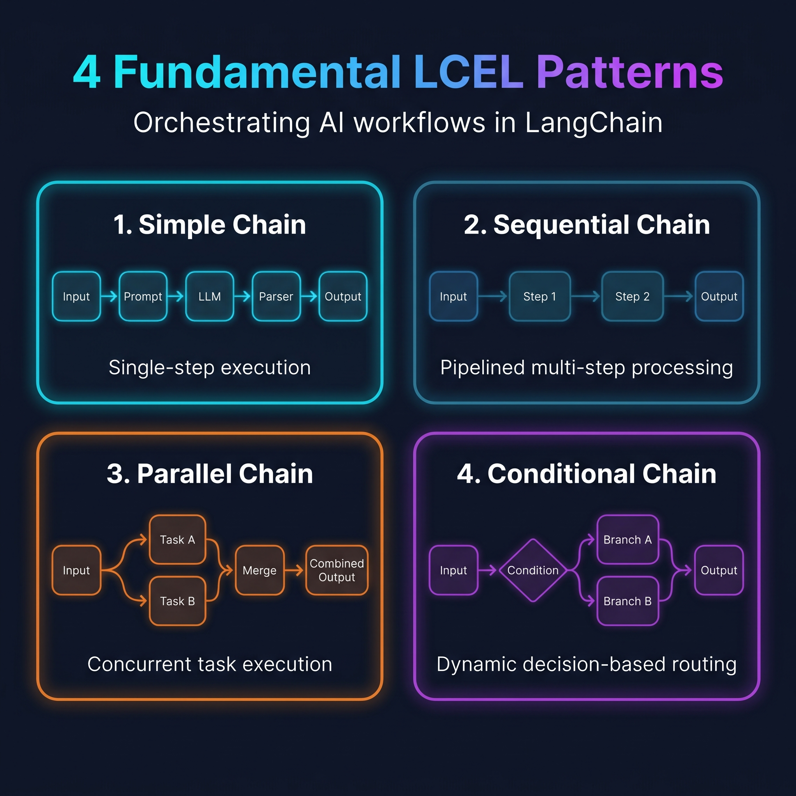

# LangChain LCEL Design Patterns

A practical guide and reference implementation of core **LangChain Expression Language (LCEL)** primitives using Google Gemini models.

---

## 📌 Architecture & Chain Patterns

### 🔄 LCEL Workflow Overview


This diagram illustrates the four LCEL patterns covered in this project.


This project explores four architectural patterns supported by LCEL, progressing from basic composition to parallel execution and conditional branching.

### 1. Simple Linear Chain

A standard pipe workflow that passes dynamic variables into a prompt, queries the model, and parses the response into plain text.

**Flow:**

`Input → PromptTemplate → Model → StrOutputParser → Output`

**Use Cases:** Single-turn Q&A, basic text summarization, translation, and zero-shot content generation.

---

### 2. Sequential (Pipelined) Chain

Links multiple generation steps sequentially, where the parsed output of the first stage becomes an input to the next prompt.

**Flow:**

`Topic → Detailed Report → Concise Summary`

**Use Cases:** Multi-step workflows, sequential data processing, and tasks requiring multiple connected operations.

---

### 3. Parallel Chain (`RunnableParallel`)

Executes independent operations concurrently over the same input, then combines their outputs into a consolidated document.

**Flow:**

`Input Text → (Study Notes + Quiz Questions) → Merge Chain → Combined Output`

**Key Concept:** `RunnableParallel` executes independent branches concurrently and returns their results as a dictionary, making them available to the next stage.

**Use Cases:** Concurrent task execution, independent data processing, and combining multiple results.

---

### 4. Conditional Chain (`RunnableBranch`)

Classifies user feedback using structured Pydantic output, then selects a response-generation path based on the detected sentiment.

**Flow:**

`User Feedback → Sentiment Classification → Conditional Branch → Appropriate Response`

**Key Concepts:**

- `PydanticOutputParser` — parses the model response into a structured Pydantic object.
- `RunnableBranch` — routes the input according to defined conditions.
- `RunnableLambda` — provides a fallback when no branch condition matches.

**Use Cases:** Decision-making workflows, dynamic task routing, and condition-based processing.

---

## 🛠️ Tech Stack

- **Python** — programming language
- **LangChain** — framework for building LLM applications
- **LCEL** — composing and connecting runnable components
- **Google Gemini** — language model
- **Pydantic** — structured output parsing and validation
- **python-dotenv** — environment variable management

## 📂 Project Structure

```text
langchain-lcel-patterns/
├── simple_chain.py
├── sequential_chain.py
├── parallel_chain.py
├── conditional_chain.py
├── requirements.txt
├── .env.example
├── .gitignore
└── README.md
```

## ⚙️ Setup

### 1. Clone the Repository

```bash
git clone https://github.com/JiyaSheikh06/langchain-lcel-patterns.git
cd langchain-lcel-patterns
```

### 2. Create and Activate a Virtual Environment

Create the environment:

```bash
python -m venv venv
```

Activate it on Windows PowerShell:

```powershell
.\venv\Scripts\Activate.ps1
```

### 3. Install Dependencies

```bash
pip install -r requirements.txt
```

### 4. Configure the API Key

Create a `.env` file in the project root and add your Google Gemini API key:

```env
GOOGLE_API_KEY=your_google_api_key
```

Get an API key from [Google AI Studio](https://aistudio.google.com/apikey).

**Security:** Never commit your `.env` file or expose your API key in a public repository.

## ▶️ Run the Examples

Run each example independently from the project root:

```bash
python simple_chain.py
python sequential_chain.py
python parallel_chain.py
python conditional_chain.py
```

Ensure your API key is configured before running the examples.

## 🎯 Learning Objectives

- Understand LCEL syntax and the pipe (`|`) operator.
- Connect prompt templates, language models, and output parsers.
- Build sequential and parallel execution pipelines.
- Implement conditional routing with `RunnableBranch`.
- Parse structured model outputs using Pydantic.
- Organize reusable LLM workflows with LangChain.

## 📚 Learning Focus

This project is part of my learning journey in **Generative AI and AI Engineering**, with a focus on understanding LCEL patterns and integrating structured LLM outputs into Python applications.

## 👩‍💻 Author

**Jiya Sheikh**

GitHub: [@JiyaSheikh06](https://github.com/JiyaSheikh06)
